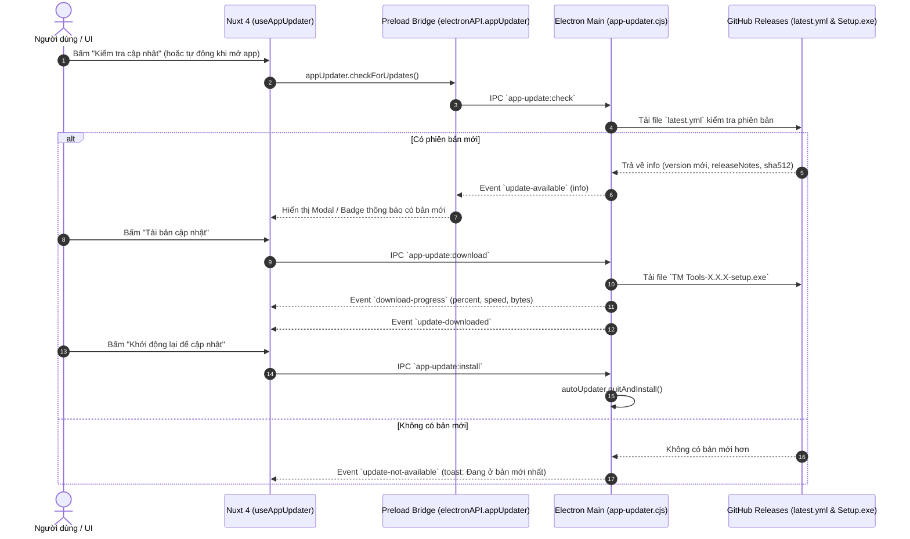
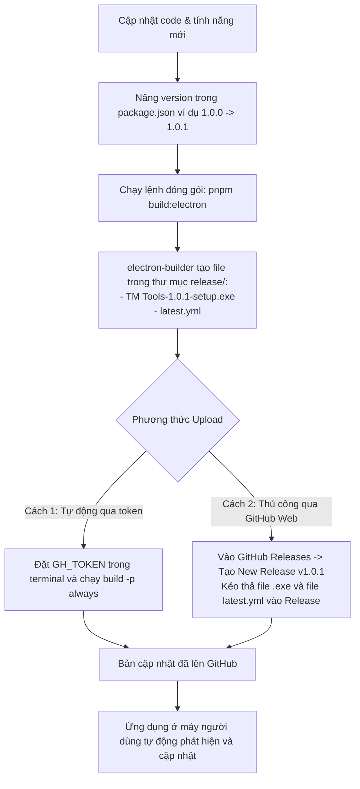

# Kế hoạch triển khai Auto Update với electron-updater

Tài liệu này mô tả chi tiết kiến trúc, quy trình và các bước kỹ thuật để xây dựng tính năng **Auto Update** (tự động kiểm tra và cập nhật ứng dụng Desktop) cho **TM Tools** sử dụng `electron-updater` và `electron-builder`, liên kết trực tiếp với GitHub Releases.

---

## User Review Required

> [!IMPORTANT]
> **Nhà phát hành (Publish Provider)**:
> Mã nguồn chính hiện tại là Private Repo, do đó để người dùng cuối có thể tự động tải các bản cập nhật công khai mà không cần token xác thực, chúng ta sử dụng **Public Repo chuyên dụng**:
> `https://github.com/tuanmjnh/tm-tools-public.git` (Owner: `tuanmjnh`, Repo: `tm-tools-public`).
> Khi đóng gói và phát hành bản mới, bạn sẽ push bản release (`latest.yml` và installer `.exe`) lên repo public này.

> [!NOTE]
> Trong môi trường phát triển (`pnpm dev:electron` - chưa đóng gói installer NSIS), `autoUpdater` mặc định sẽ thông báo ứng dụng đang chạy ở chế độ dev. Chúng ta sẽ bổ sung cơ chế kiểm tra / mô phỏng thông minh để bạn vẫn có thể test UI và luồng xử lý mà không bị crash.

---

## 1. Kiến trúc hệ thống Auto Update



---

## 2. Các thay đổi và file cần triển khai

### Component 1: Cấu hình Build & Dependencies
1. **Cài đặt thư viện**:
   - `pnpm add electron-updater`
2. **Cấu hình [electron-builder.yml](file:///d:/Applications/tm-tools/electron-builder.yml)**:
   - Khai báo trường `publish` kết nối GitHub Releases:
     ```yaml
     publish:
       provider: github
       owner: tuanmjnh
       repo: tm-tools-public
       releaseType: release
     ```

---

### Component 2: Electron Main Process & Preload Bridge
1. **[NEW] [app-updater.cjs](file:///d:/Applications/tm-tools/electron/tools/app-updater.cjs)**:
   - Module quản lý `autoUpdater`:
     - Thiết lập `autoUpdater.autoDownload = false` (chỉ tải khi người dùng đồng ý hoặc cấu hình cho phép).
     - Thiết lập `autoUpdater.autoInstallOnAppQuit = true`.
     - Đăng ký các sự kiện `checking-for-update`, `update-available`, `update-not-available`, `download-progress`, `update-downloaded`, `error`.
     - Đăng ký các IPC Handles:
       - `app-update:check`
       - `app-update:download`
       - `app-update:install`
       - `app-update:get-status`
2. **[MODIFY] [electron/main.cjs](file:///d:/Applications/tm-tools/electron/main.cjs)**:
   - Khởi tạo `registerAppUpdaterController(win)` khi cửa sổ chính sẵn sàng.
3. **[MODIFY] [electron/preload.cjs](file:///d:/Applications/tm-tools/electron/preload.cjs)**:
   - Expose `electronAPI.appUpdater` an toàn qua `contextBridge`:
     - `checkForUpdates()`
     - `downloadUpdate()`
     - `quitAndInstall()`
     - `getStatus()`
     - `onProgress(callback)`
     - `onUpdateAvailable(callback)`
     - `onUpdateDownloaded(callback)`
     - `onError(callback)`

---

### Component 3: Nuxt 4 Composables & Quản lý trạng thái
1. **[NEW] [app/composables/useAppUpdater.ts](file:///d:/Applications/tm-tools/app/composables/useAppUpdater.ts)**:
   - Quản lý trạng thái cập nhật toàn cục:
     - `status`: `'idle' | 'checking' | 'available' | 'not-available' | 'downloading' | 'downloaded' | 'error'`
     - `currentVersion`: phiên bản hiện tại từ Electron / package.json
     - `latestVersion`: phiên bản mới nhất từ GitHub
     - `releaseNotes`: ghi chú phát hành (Changelog)
     - `progress`: `{ percent: number, bytesPerSecond: number, transferred: number, total: number }`
     - `isUpdateModalOpen`: điều khiển modal cập nhật
   - Hàm `checkForUpdates(silent?: boolean)`: hỗ trợ kiểm tra im lặng khi app mở lên hoặc kiểm tra chủ động có thông báo.
   - Hàm `startDownload()`
   - Hàm `quitAndInstall()`

---

### Component 4: Giao diện người dùng (UI / UX)
1. **[NEW] [app/components/dashboard/AppUpdateModal.vue](file:///d:/Applications/tm-tools/app/components/dashboard/AppUpdateModal.vue)**:
   - Modal hiển thị chi tiết cập nhật:
     - So sánh `Current Version` -> `New Version` với thẻ badge nổi bật.
     - Khung hiển thị Changelog / Release Notes.
     - Thanh tiến trình tải `UProgress` kèm tốc độ tải (MB/s) và phần trăm.
     - Các nút thao tác: "Cập nhật ngay", "Khởi động lại để cập nhật", "Để sau".
2. **[MODIFY] [app/layouts/default.vue](file:///d:/Applications/tm-tools/app/layouts/default.vue)**:
   - Ở chân Sidebar phần hiển thị `Version: 1.0.0`:
     - Biến thành nút tương tác nhỏ gọn hoặc thêm icon chuông / chấm xanh khi có bản cập nhật mới.
     - Bấm vào sẽ mở `AppUpdateModal`.
3. **[MODIFY] [app/components/dashboard/UserMenu.vue](file:///d:/Applications/tm-tools/app/components/dashboard/UserMenu.vue)**:
   - Bổ sung menu item: *"Kiểm tra cập nhật"* (`i-lucide-arrow-up-circle`).
4. **[MODIFY] [i18n/locales/vi.json](file:///d:/Applications/tm-tools/i18n/locales/vi.json) & [i18n/locales/en.json](file:///d:/Applications/tm-tools/i18n/locales/en.json)**:
   - Bổ sung toàn bộ nhãn ngôn ngữ song ngữ cho hệ thống Auto Update (`appUpdate.*`).

---

## 3. Quy trình phát hành bản cập nhật mới (Release Workflow)

Để hệ thống tự động cập nhật hoạt động ngoài thực tế, quy trình phát hành sẽ như sau:



### Chi tiết 2 bước khi phát hành bản mới:
1. **Tạo Release tự động qua CLI**:
   ```powershell
   $env:GH_TOKEN="ghp_xxxxxx"
   pnpm build
   npx electron-builder --win --publish always
   ```
2. **Hoặc Tạo Release thủ công**:
   - Chạy `pnpm build:electron` -> Thư mục `release/` sẽ chứa `TM Tools-1.0.1-setup.exe` và `latest.yml`.
   - Lên GitHub repo `tuanmjnh/tm-tools` -> Releases -> Draft a new release.
   - Tag: `v1.0.1`. Title: `TM Tools v1.0.1`.
   - Upload cả 2 file: `TM Tools-1.0.1-setup.exe` và `latest.yml`.
   - Bấm **Publish release**.

---

## Verification Plan

### 1. Kiểm tra môi trường Dev:
- Khởi chạy app qua `pnpm dev:electron`.
- Thử kích hoạt kiểm tra cập nhật từ User Menu và từ chân Sidebar.
- Xác nhận các sự kiện IPC hoạt động trơn tru, hiển thị trạng thái chuẩn xác, không gây crash ứng dụng.

### 2. Kiểm tra chất lượng mã nguồn:
- Chạy `pnpm lint` (eslint) trên toàn bộ các file mới và file chỉnh sửa.
- Chạy `pnpm typecheck` (vue-tsc) đảm bảo 0 lỗi kiểu dữ liệu.

### 3. Kiểm tra thử nghiệm đóng gói:
- Chạy thử `pnpm build:electron` để kiểm tra `electron-builder` tạo ra bộ cài đặt và file `latest.yml` chuẩn xác.
