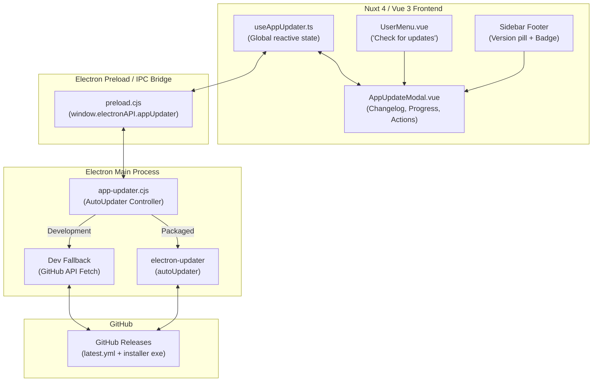

# Walkthrough: Xây dựng Tính năng Auto Update với Electron Updater & GitHub Releases

## Tổng quan

Chúng ta đã thiết kế và triển khai hoàn thiện giải pháp **Auto Update** toàn diện cho ứng dụng Desktop (Electron + Nuxt 4) bằng thư viện `electron-updater`, tích hợp trực tiếp với repo public **GitHub Releases** (`tuanmjnh/tm-tools-public`).

Hệ thống hoạt động trơn tru cả ở môi trường phát triển (Development / `dev:electron` - fallback trực tiếp qua GitHub API) và môi trường đóng gói sản phẩm (Production / `.exe` installer).

---

## Kiến trúc Hệ thống



---

## Các thành phần đã triển khai

### 1. Cấu hình `electron-builder`
- File: [electron-builder.yml](file:///d:/Applications/tm-tools/electron-builder.yml)
- Bổ sung cấu hình `publish`:
  ```yaml
  publish:
    provider: github
    owner: tuanmjnh
    repo: tm-tools-public
    releaseType: release
  ```

### 2. Main Process Controller & IPC Handlers
- File: [electron/tools/app-updater.cjs](file:///d:/Applications/tm-tools/electron/tools/app-updater.cjs)
- Quản lý vòng đời cập nhật:
  - `getStatus`: Lấy trạng thái hiện tại (idle, checking, available, not-available, downloading, downloaded, error).
  - `checkForUpdates`: Kiểm tra bản mới qua `autoUpdater.checkForUpdates()`. Trong môi trường dev, tự động truy vấn trực tiếp GitHub Releases API để test UI mà không gặp lỗi file cấu hình.
  - `downloadUpdate`: Bắt đầu tải file cài đặt ngầm.
  - `quitAndInstall`: Tự động thoát ứng dụng và kích hoạt bộ cài mới để cập nhật.
- Lắng nghe các event từ `autoUpdater`: `checking-for-update`, `update-available`, `update-not-available`, `download-progress`, `update-downloaded`, `error` và gửi broadcast qua webContents `app-update:status-changed`.
- Tích hợp vào [electron/main.cjs](file:///d:/Applications/tm-tools/electron/main.cjs).

### 3. Preload Bridge & TypeScript Types
- File: [electron/preload.cjs](file:///d:/Applications/tm-tools/electron/preload.cjs) & [types/electron.ts](file:///d:/Applications/tm-tools/types/electron.ts)
- Định nghĩa type-safe namespace `window.electronAPI.appUpdater` hỗ trợ đầy đủ autocomplete và validation.

### 4. Vue Composable State Management
- File: [app/composables/useAppUpdater.ts](file:///d:/Applications/tm-tools/app/composables/useAppUpdater.ts)
- Cung cấp:
  - Trạng thái reactive chia sẻ toàn app: `isAvailable`, `isDownloading`, `isDownloaded`, `updateInfo`, `progress`, `showModal`.
  - Tự động kiểm tra bản cập nhật sau 5 giây khi khởi động ứng dụng (tự động dọn dẹp listener khi unmount).

### 5. Giao diện Người dùng (UI / UX)
- **Modal Cập nhật Hiện đại**: [app/components/dashboard/AppUpdateModal.vue](file:///d:/Applications/tm-tools/app/components/dashboard/AppUpdateModal.vue)
  - Hiển thị so sánh phiên bản (Hiện tại ➜ Mới nhất).
  - Khối Release Notes / Changelog đẹp mắt (hỗ trợ cuộn, hiển thị ngày phát hành).
  - Thanh tiến trình tải mượt mà với tốc độ (MB/s), dung lượng đã tải và phần trăm (%).
  - Nút "Cài đặt & Khởi động lại" (`quitAndInstall`) khi đã tải xong.
- **Sidebar Footer Trigger**: [app/layouts/default.vue](file:///d:/Applications/tm-tools/app/layouts/default.vue)
  - Pill hiển thị version `vX.Y.Z` ở chân sidebar có thể click để mở modal kiểm tra.
  - Badge nhấp nháy xanh lá cây (`animate-pulse`) tự động xuất hiện khi có bản cập nhật mới.
- **User Dropdown Menu**: [app/components/dashboard/UserMenu.vue](file:///d:/Applications/tm-tools/app/components/dashboard/UserMenu.vue)
  - Thêm mục menu **"Kiểm tra cập nhật"** với icon `i-lucide-sparkles`.
- **Đa ngôn ngữ i18n**: Cung cấp đầy đủ các chuỗi `appUpdate.*` cho cả tiếng Việt [i18n/locales/vi.json](file:///d:/Applications/tm-tools/i18n/locales/vi.json) và tiếng Anh [i18n/locales/en.json](file:///d:/Applications/tm-tools/i18n/locales/en.json).

---

## Quy trình Phát hành Bản Cập Nhật Mới (Release Workflow)

Dưới đây là 2 cách để phát hành một bản cập nhật mới lên GitHub Releases:

### Cách 1: Tự động Build & Publish qua CLI (Khuyên dùng)

1. **Tạo GitHub Personal Access Token (PAT)**:
   - Truy cập GitHub: **Settings > Developer Settings > Personal Access Tokens > Tokens (classic)**.
   - Chọn scope `repo` (quyền đọc/ghi repo). Copy token.
2. **Cập nhật Version trong `package.json`**:
   - Ví dụ nâng từ `"version": "1.0.0"` lên `"version": "1.0.1"`.
3. **Chạy lệnh đóng gói và publish**:
   ```powershell
   # Thiết lập token tạm thời trong terminal PowerShell
   $env:GH_TOKEN="ghp_yourPersonalAccessTokenHere"

   # Chạy build Electron và publish trực tiếp
   pnpm build:electron -- --publish always
   ```
   *`electron-builder` sẽ tự động build app, tạo bản draft release trên GitHub, upload file `.exe` cùng file checksum `latest.yml`, sau đó publish release.*

---

### Cách 2: Build Thủ Công và Upload lên GitHub Releases

1. **Nâng phiên bản** trong `package.json` (ví dụ `1.0.1`).
2. **Chạy lệnh build ứng dụng**:
   ```bash
   pnpm build:electron
   ```
3. Sau khi build xong, mở thư mục `release/` (thư mục đầu ra được định nghĩa trong `electron-builder.yml`), bạn sẽ thấy các tệp quan trọng:
   - `tm-tools-1.0.1-setup.exe` (bản installer chính)
   - `tm-tools-1.0.1-setup.exe.blockmap`
   - `latest.yml` (chứa sha512 và kích thước file dùng cho electron-updater đối soát)
4. **Tạo Release trên GitHub**:
   - Vào repository GitHub Public: `https://github.com/tuanmjnh/tm-tools-public/releases`.
   - Bấm **Draft a new release**.
   - **Tag version**: nhập `v1.0.1` (trùng với version trong package.json).
   - **Release title**: nhập tên bản phát hành (ví dụ: `v1.0.1 - Tính năng mới & sửa lỗi`).
   - Viết ghi chú cập nhật (Changelog).
   - **Kéo và thả các tệp sau vào ô Attach binaries**:
     - `tm-tools Setup 1.0.1.exe`
     - `tm-tools Setup 1.0.1.exe.blockmap`
     - `latest.yml` *(Cực kỳ quan trọng: electron-updater cần file này để biết hash sha512 và version mới nhất)*
   - Bấm **Publish release**.

Ngay khi release được công khai, toàn bộ người dùng đang mở ứng dụng phiên bản `1.0.0` sẽ nhận được thông báo bản mới, có thể bấm tải ngầm và tự động khởi động lại để cập nhật!
