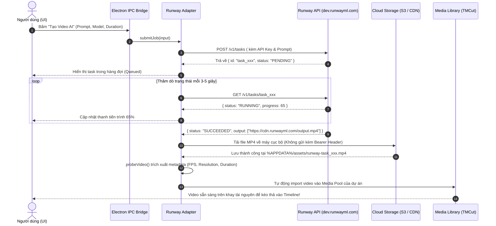

# Hướng Dẫn Cấu Hình Hệ Thống Assets & Tích Hợp RunwayML Video AI (https://dev.runwayml.com)

Tài liệu này cung cấp hướng dẫn chuyên sâu về kiến trúc quản lý tài nguyên đa phương tiện (**Assets Management System**) trong **TM Tools** và các bước thiết lập, tích hợp bộ tạo video AI thế hệ mới thông qua **Runway Developer API** ([https://dev.runwayml.com](https://dev.runwayml.com)).

---

## PHẦN 1: KIẾN TRÚC & CẤU HÌNH HỆ THỐNG ASSETS CỦA TM TOOLS

Trong hệ sinh thái TM Tools và phòng dựng **TMCut Video Studio**, Assets là hạt nhân của mọi dự án biên tập. Hệ thống quản lý Assets được thiết kế theo mô hình phân tầng hiệu năng cao nhằm đảm bảo việc dựng video mượt mà, không phụ thuộc hoàn toàn vào tốc độ mạng.

### 1.1. Các tầng lưu trữ tài nguyên (Storage Tiers)

```
┌────────────────────────────────────────────────────────────────────────┐
│                        ASSETS MANAGEMENT PIPELINE                      │
├────────────────────────────────┬───────────────────────────────────────┤
│ TẦNG 1: LOCAL STORAGE          │ - Thư mục AppData cục bộ của máy tính │
│ (Hiệu năng cao, độ trễ 0ms)    │ - Cache video, audio waveform, proxies│
│                                │ - Đường dẫn: %APPDATA%/tm-tools/assets│
├────────────────────────────────┼───────────────────────────────────────┤
│ TẦNG 2: CLOUD MEDIA STORAGE    │ - Cloudinary / Supabase Storage       │
│ (Đồng bộ dự án & chia sẻ)      │ - Tải lên & phát trực tiếp qua CDN    │
│                                │ - Cấu hình tập trung tại TM Hub       │
├────────────────────────────────┼───────────────────────────────────────┤
│ TẦNG 3: IN-MEMORY & SCRATCH    │ - Bộ nhớ đệm RAM và thư mục tạm thời  │
│ (Xử lý render & preview)       │ - Chứa clip cắt thử, frame cache      │
└────────────────────────────────┴───────────────────────────────────────┘
```

1. **Local Storage Tier (Cục bộ)**:
   - Dành cho ứng dụng **TM Tools Desktop (Electron)**.
   - Toàn bộ video gốc dung lượng lớn được đọc trực tiếp từ ổ đĩa cứng thông qua giao thức file nội bộ (`file://` hoặc custom protocol `atom://`), giúp Timeline chạy ở tốc độ 60 FPS mà không bị trễ mạng.
   - Thư mục lưu trữ mặc định:
     - **Windows**: `%APPDATA%\tm-tools\assets\` hoặc `C:\Users\<username>\AppData\Roaming\tm-tools\assets\`
     - **macOS**: `~/Library/Application Support/tm-tools/assets/`
     - **Linux**: `~/.config/tm-tools/assets/`
2. **Cloud Storage Tier (Đám mây)**:
   - Tích hợp với dịch vụ **Cloudinary** hoặc **Supabase Storage**.
   - Lưu trữ các tài nguyên dùng chung: Mẫu video (Templates), hiệu ứng âm thanh (SFX), nhãn dán (Stickers), font chữ và video đã xuất bản.
3. **Thumbnail & Waveform Cache**:
   - Khi nhập bất kỳ file media nào vào, hệ thống tự động trích xuất thông tin kỹ thuật bằng `ffprobe` và sinh ảnh thu nhỏ (thumbnail) cùng dữ liệu sóng âm (audio waveform) để hiển thị mượt mà trên Timeline.

---

### 1.2. Vòng đời xử lý Asset (Asset Processing Lifecycle)

Mỗi file khi đưa vào hệ thống đều trải qua 5 bước tiêu chuẩn:

1. **Ingestion (Tiếp nhận)**:
   - Hỗ trợ kéo thả trực tiếp tệp từ máy tính hoặc dán liên kết URL (hỗ trợ nhập từ web hoặc cloud).
   - Kiểm tra định dạng hợp lệ: Video (`.mp4`, `.mov`, `.webm`), Audio (`.mp3`, `.wav`, `.aac`), Image (`.png`, `.jpg`, `.webp`).
2. **Probing (Phân tích chỉ số)**:
   - Module `electron/tools/video-generation/video-probe.mjs` sử dụng thư viện `ffprobe` tích hợp sẵn để đọc:
     - Độ phân giải thực (`width`, `height`).
     - Tốc độ khung hình thực (`fps`).
     - Thời lượng chính xác đến mili-giây (`durationMs`).
     - Codec video (`h264`, `hevc`, `vp9`) và codec âm thanh (`aac`, `mp3`).
3. **Proxy Generation (Tạo bản nháp tối ưu)**:
   - Đối với các video 4K hoặc bitrate cực lớn, hệ thống có thể tạo phiên bản proxy 720p nhẹ hơn để bạn dựng clip không bị giật lag. Khi xuất video thành phẩm (Export), hệ thống sẽ tự động chuyển về video gốc 4K để render.
4. **Timeline Slot Mapping**:
   - Gán ID duy nhất (`assetId`) cho file và ánh xạ vào các track tương ứng trong Timeline.
5. **Cleanup & Garbage Collection**:
   - Tự động dọn dẹp các file cache tạm thời sau khi dự án hoàn thành để giải phóng dung lượng ổ cứng.

---

### 1.3. Cấu hình biến môi trường cho Cloud Assets

Để kích hoạt lưu trữ đám mây cho Assets, khai báo tại `tm-hub/.env` hoặc bảng cấu hình của Hub:

```env
# Cloudinary Storage Configuration
CLOUDINARY_CLOUD_NAME=your_cloud_name
CLOUDINARY_API_KEY=your_api_key
CLOUDINARY_API_SECRET=your_api_secret

# Supabase Storage Bucket
SUPABASE_STORAGE_BUCKET=tm-media-assets
```

---

## PHẦN 2: HƯỚNG DẪN TÍCH HỢP RUNWAYML VIDEO GENERATION API (https://dev.runwayml.com)

**RunwayML** là nền tảng AI sinh video hàng đầu thế giới với các mô hình đột phá như **Gen-3 Alpha** và **Gen-3 Alpha Turbo**. TM Tools đã tích hợp sẵn **Runway Video Generation Adapter** trực tiếp trong lõi Electron, cho phép bạn biến văn bản thành video hoặc biến hình ảnh tĩnh thành thước phim chuyển động chất lượng cao.

Cổng thông tin lập trình viên chính thức: **[https://dev.runwayml.com](https://dev.runwayml.com)**

---

### 2.1. Bước 1: Đăng Ký Tài Khoản & Lấy API Key Từ Runway

1. Truy cập trang chủ nhà phát triển Runway: **[https://dev.runwayml.com](https://dev.runwayml.com)** (hoặc [https://runwayml.com](https://runwayml.com)).
2. Nhấn **Get Started** hoặc **Sign In** để đăng nhập bằng tài khoản Runway.
3. Chuyển đến mục **API Settings** / **Developer Dashboard**.
4. Chọn tab **API Keys** và nhấn nút **Create Secret Key**:
   - Đặt tên cho khóa: ví dụ `TM_TOOLS_PRODUCTION`.
   - Sao chép chuỗi khóa bí mật vừa tạo (chuỗi khóa thường có tiền tố `key_...`).
   - *Lưu ý quan trọng*: Runway chỉ hiển thị khóa này **duy nhất một lần**. Hãy lưu khóa vào nơi an toàn.
5. Kiểm tra mục **Usage & Billing**:
   - Đảm bảo tài khoản đã kích hoạt gói trả phí hoặc đã nạp credit để thực hiện gọi API.
   - Hạn mức mặc định thông thường là **20 RPM** (Requests Per Minute).

---

### 2.2. Bước 2: Thiết Lập Biến Môi Trường (Environment Configuration)

Bạn có 2 cách để cấu hình khóa Runway vào hệ sinh thái TM Tools:

#### Cách 1: Cấu hình trực tiếp tại `tm-tools/.env` (Khuyên dùng khi phát triển cục bộ)
Mở file `d:\Applications\tm-tools\.env` và bổ sung 2 dòng cấu hình:

```env
# =============================================================================
#  Runway Video Generation AI Configuration
#  Official Docs: https://dev.runwayml.com/docs/api-reference
# =============================================================================
RUNWAY_API_KEY=key_xxxxxxxxxxxxxxxxxxxxxxxxxxxxxxxxxxxxxxxxxxxx
RUNWAY_BASE_URL=https://api.runwayml.com/v1
```

#### Cách 2: Quản lý tập trung qua TM Hub Control Plane (An toàn cho doanh nghiệp)
1. Đăng nhập TM Hub tại `https://tm-hub-app.vercel.app`.
2. Vào menu **Administration** > **Configs** (`/administration/configs`).
3. Nhấn **Tạo cấu hình** và điền:
   - **Key**: `RUNWAY_API_KEY`
   - **Loại dữ liệu**: `Secret / Khóa bí mật` (Giá trị được mã hóa AES-256-GCM trên cơ sở dữ liệu)
   - **Danh mục**: `ai` hoặc `connections`
   - **Giá trị**: Dán chuỗi `key_...` của Runway vào đây.
4. TM Tools sẽ tự động đồng bộ khóa này về khi khởi động thông qua `useHub()`.

---

### 2.3. Bước 3: Các Mô Hình & Thông Số Kỹ Thuật Hỗ Trợ

Adapter của TM Tools (`electron/tools/video-generation/runway-adapter.mjs`) hỗ trợ các mô hình chính thức theo tài liệu Runway API (`X-Runway-Version: 2024-11-06`):

| Tên mô hình | Mã Model (`model`) | Thời lượng tối đa | Chi phí ước tính | Đặc điểm chính |
| :--- | :--- | :--- | :--- | :--- |
| **Gen-3 Alpha** | `gen3a` | 10 giây | ~$0.05 / giây | Chất lượng điện ảnh cao cấp nhất, độ chân thực cao, ánh sáng và chi tiết vật lý hoàn hảo |
| **Gen-3 Alpha Turbo** | `gen3a-turbo` | 10 giây | ~$0.03 / giây | Tốc độ xử lý nhanh hơn gấp nhiều lần, chi phí tối ưu, rất phù hợp cho sản xuất nội dung hàng loạt |

#### Các chế độ tạo video hỗ trợ:
1. **Text-to-Video (Văn bản thành Video)**:
   - Tạo ra cảnh quay hoàn toàn mới dựa trên câu lệnh mô tả chi tiết (Prompt).
   - Hỗ trợ câu lệnh phủ định (`negative_prompt`) để loại bỏ các chi tiết không mong muốn (ví dụ: mờ, biến dạng, chữ ký, xấu).
2. **Image-to-Video (Ảnh thành Video)**:
   - Đưa vào một bức ảnh tĩnh ban đầu (`image` qua URL công khai hoặc base64).
   - Mô hình sẽ chuyển động hóa bức ảnh theo câu lệnh prompt mô tả hành động (ví dụ: "nhân vật mỉm cười và vẫy tay, máy quay di chuyển chậm về phía trước").
3. **Kích thước & Độ phân giải (Resolution)**:
   - Chuẩn 16:9 ngang: `1280x720` (hoặc `1920x1080` tùy tài khoản).
   - Chuẩn 9:16 dọc: `720x1280` (tối ưu cho video ngắn TikTok, Reels, Shorts).

---

### 2.4. Bước 4: Vòng Đời Xử Lý Tác Vụ Bất Đồng Bộ (Async Job Flow)

Quá trình sinh video AI mất từ 30 giây đến 2 phút tùy theo độ dài và lưu lượng của Runway. Hệ thống xử lý theo quy trình bất đồng bộ chuyên nghiệp:



> **Ghi chú kỹ thuật quan trọng**:
> Khi tải video thành phẩm từ liên kết `output` do Runway trả về, liên kết này là dạng **Presigned URL của Amazon S3 hoặc Google Cloud**.
> Mã nguồn adapter đã được tối ưu: **Tuyệt đối không gửi kèm header `Authorization: Bearer`** khi tải từ presigned URL, vì máy chủ S3 sẽ chặn và trả về lỗi `HTTP 400 Bad Request` nếu vừa có chữ ký URL vừa có header xác thực.

---

### 2.5. Bước 5: Kiểm Thử Hoạt Động (Testing & Verification)

TM Tools đã tích hợp sẵn bộ kiểm thử đơn vị (Unit Tests) cho Runway Adapter để bạn có thể kiểm tra kết nối và tính toàn vẹn của code bất kỳ lúc nào:

1. Mở cửa sổ terminal tại thư mục `d:\Applications\tm-tools`.
2. Chạy lệnh kiểm thử chuyên biệt cho Runway:
   ```bash
   pnpm test:runway
   ```
3. Chạy kiểm thử toàn diện hệ thống Runner:
   ```bash
   pnpm test
   ```
4. Khi kết quả trả về `passed`, nghĩa là module đã sẵn sàng 100% để phục vụ người dùng.

---

### 2.6. Bước 6: Xử Lý Lỗi & Quản Trị Chi Phí (Error Handling & Quotas)

| Mã lỗi / Tình huống | Nguyên nhân | Cách xử lý |
| :--- | :--- | :--- |
| **`no-key`** | Biến `RUNWAY_API_KEY` chưa được khai báo hoặc rỗng. | Kiểm tra file `.env` hoặc cấu hình trên TM Hub và khởi động lại Electron. |
| **`rate-limited (HTTP 429)`** | Vượt quá số lượng request cho phép trong 1 phút (quá 20 RPM). | Adapter tự động kích hoạt cơ chế chờ (backoff); hãy giãn cách thời gian giữa các lần bấm sinh video. |
| **`invalid-input`** | Thiếu câu lệnh Prompt hoặc ảnh đầu vào khi chọn chế độ `image-to-video`. | Kiểm tra lại dữ liệu nhập trên form UI trước khi bấm gửi. |
| **`timeout`** | Quá trình sinh video vượt quá thời gian tối đa 5 phút (`300000ms`). | Kiểm tra trạng thái máy chủ Runway tại trang [status.runwayml.com](https://status.runwayml.com). |
| **Hủy tác vụ giữa chừng** | Người dùng bấm nút **Hủy (Cancel)** trên giao diện. | Hệ thống tự động gửi yêu cầu `POST /v1/tasks/:id/cancel` tới Runway để ngừng tính chi phí tác vụ. |

---

## 3. Tài Liệu Hướng Dẫn Liên Quan

* 📖 **[Hướng Dẫn Sử Dụng TM Tools Cho Người Dùng (User Guide)](./user-guide.md)**: Hướng dẫn chi tiết thao tác dựng video, quản lý Profile và công cụ tiện ích.
* ⚙️ **[Hướng Dẫn Cài Đặt & Cấu Hình Hệ Thống](./system-setup-and-configuration-guide.md)**: Cài đặt biến môi trường, seed database và khởi chạy.
* 🏪 **[Hướng Dẫn Cấu Hình & Đẩy Asset Lên Marketplace](./asset-marketplace-guide.md)**: Đóng gói tài nguyên, kiểm tra bản quyền và xuất bản lên Marketplace.
