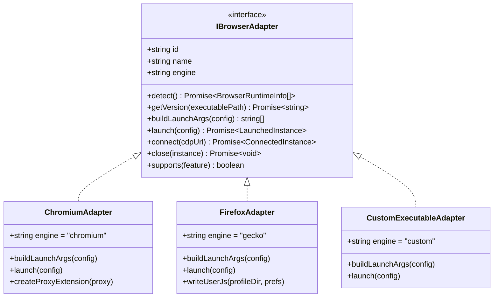

# BROWSER PROFILE MANAGEMENT PLATFORM — ARCHITECTURE SPECIFICATION

> **Phiên bản:** 1.0.0  
> **Trạng thái:** Thiết kế kiến trúc phê duyệt (Architecture Baseline)  
> **Nguyên tắc cốt lõi:** Local-First, Clean Architecture (Layered), Zero-Trust IPC, Safe Process Isolation.

---

## 1. TỔNG QUAN HỆ THỐNG & TRIẾT LÝ THIẾT KẾ

Platform quản trị Browser Profile được thiết kế theo hướng **Enterprise Desktop Application**, hoạt động hoàn toàn **Local-First**, độc lập không phụ thuộc máy chủ từ xa, đảm bảo sự an toàn dữ liệu, tính riêng tư và khả năng kiểm thử/tự động hóa mạnh mẽ.

### 1.1. Phạm vi & Mục đích Hợp pháp
- **Profile Isolation**: Mỗi profile sở hữu một môi trường lưu trữ (User Data Directory) độc lập hoàn toàn (cache, cookies, local storage, indexedDB, session, extensions).
- **Multi-Runtime Orchestration**: Quản lý nhiều nhân trình duyệt đồng thời (Google Chrome, Chromium, Mozilla Firefox, Brave, Microsoft Edge, Custom Executable).
- **Privacy & QA Testing**: Cấu hình kiểm thử môi trường, timezone, geolocation, proxy, và thiết bị phục vụ phát triển phần mềm và kiểm thử chất lượng (QA/Dev).
- **Compliant Automation**: Tự động hóa trình duyệt qua Playwright / Chrome DevTools Protocol (CDP) cho các tác vụ hợp pháp (data scraping nội bộ, kiểm thử UI tự động, workflow tự động).
- **Ranh giới an toàn (Strict Ethical Boundary)**: Hệ thống **KHÔNG** xây dựng bất kỳ tính năng nào nhằm mục đích vượt qua CAPTCHA, chống gian lận (anti-fraud), anti-bot hay qua mặt các cơ chế xác thực danh tính của các website.

---

## 2. PHÂN TẦNG KIẾN TRÚC (STRICT LAYERED ARCHITECTURE)

Hệ thống tuân thủ nghiêm ngặt nguyên tắc **Clean Architecture** gồm 4 tầng phân lập rõ ràng:

```
┌─────────────────────────────────────────────────────────────────────────┐
│                           PRESENTATION LAYER                            │
│  (Nuxt 4, Vue 3, Pinia, Nuxt UI v4 / Tailwind v4, LocalStorage Prefs)   │
└────────────────────────────────────┬────────────────────────────────────┘
                                     │  (Preload ContextBridge + Typed IPC)
                                     ▼
┌─────────────────────────────────────────────────────────────────────────┐
│                            APPLICATION LAYER                            │
│   (Use Cases, IPC Handlers, Zod Validation, EventBus Dispatchers)       │
└────────────────────────────────────┬────────────────────────────────────┘
                                     │
                                     ▼
┌─────────────────────────────────────────────────────────────────────────┐
│                              DOMAIN LAYER                               │
│  (Entities, Values, Repository Interfaces, Adapter Interfaces, Events)  │
└────────────────────────────────────┬────────────────────────────────────┘
                                     │
                                     ▼
┌─────────────────────────────────────────────────────────────────────────┐
│                          INFRASTRUCTURE LAYER                           │
│  (SQLite + Drizzle ORM, Browser Process Spawner, Playwright Adapter,    │
│   Electron safeStorage, FileSystem StorageManager, Logger)              │
└─────────────────────────────────────────────────────────────────────────┘
```

### 2.1. Chi tiết các tầng

#### Tầng 1: Presentation Layer (Renderer Process)
- **Công nghệ**: Nuxt 4 (SPA/Desktop mode), Vue 3 (`<script setup lang="ts">`), Pinia Stores, Nuxt UI v4.
- **Ranh giới nghiêm ngặt**:
  - Tuyệt đối **KHÔNG** import Node.js APIs (`fs`, `child_process`, `path`, `os`, `net`).
  - Tuyệt đối **KHÔNG** truy cập trực tiếp SQLite, Drizzle ORM hay file database.
  - Toàn bộ giao tiếp với Backend đều phải qua `window.electronAPI[domain][action]()`.
  - **Quy tắc LocalStorage**: Chỉ lưu trữ UI preferences cá nhân (giao diện dark/light, trạng thái thu gọn sidebar, bộ lọc trang hiện tại, chế độ xem table/grid, ngôn ngữ en/vi, đường dẫn trang gần nhất). Tuyệt đối không lưu dữ liệu nghiệp vụ (profiles, proxies, tokens, accounts, secrets) trong LocalStorage.

#### Tầng 2: Application Layer (Electron Main Process)
- **Nhiệm vụ**: Nhận IPC requests từ Renderer, phân phối xử lý tới Domain và Infrastructure, trả kết quả có cấu trúc `ApiResponse<T>`.
- **Validation**: Mọi input truyền qua IPC đều được parse và validate thông qua **Zod Schema**. Nếu không hợp lệ, lập tức trả lỗi và chặn đứng ở cổng IPC.
- **EventBus**: Phát tín hiệu sự kiện thời gian thực (real-time broadcast) ngược lại cho Renderer: `profile:started`, `profile:stopped`, `profile:crashed`, `browser:started`, `browser:closed`, `task:started`, `task:progress`, `task:completed`, `task:failed`.

#### Tầng 3: Domain Layer (Pure TypeScript Core)
- Chứa toàn bộ nghiệp vụ lõi độc lập với framework:
  - **Entities**: `Profile`, `BrowserRuntime`, `Proxy`, `Task`, `Workflow`, `Group`, `Tag`, `Account`.
  - **Interfaces**:
    - `IBrowserAdapter`: Định nghĩa trừu tượng cho các nhân trình duyệt (Chromium, Firefox, Custom).
    - `IAutomationAdapter`: Định nghĩa trừu tượng cho automation engine (Playwright / CDP).
    - `Repositories`: `IProfileRepository`, `IBrowserRepository`, `IProxyRepository`, `ITaskRepository`, `IWorkflowRepository`, `ISettingsRepository`.
  - **Domain Events**: Sự kiện định nghĩa nghiệp vụ tiến trình và trạng thái.

#### Tầng 4: Infrastructure Layer (Electron & Native Execution)
- **Database**: SQLite chạy qua `better-sqlite3`, ánh xạ schema qua **Drizzle ORM**, quản lý phiên bản bảng bằng Drizzle Migrations.
- **Runtime Process Management**: `BrowserProcessManager` quản lý PID, kiểm soát vòng đời tiến trình, lắng nghe biến cố `exit`/`error`, ngắt tiến trình sạch sẽ (graceful shutdown) hoặc cưỡng chế (`taskkill` / `SIGKILL`).
- **Security Storage**: Sử dụng Electron `safeStorage` để mã hóa mật khẩu proxy, account credentials, secret keys trước khi lưu vào SQLite.
- **Storage Manager**: Quản lý thư mục vật lý theo quy hoạch chuẩn.

---

## 3. THIẾT KẾ CÁC MODULE QUẢN LÝ (SYSTEM MANAGERS)

Hệ thống được chia thành 11 module quản trị độc lập (Separation of Concerns), không tạo Giant Service hay God Object:

```
electron/src/
├── core/
│   ├── EventBus.ts                  # Event dispatcher trung tâm
│   └── Logger.ts                    # Structured logging (file + console)
├── modules/
│   ├── profile/
│   │   ├── ProfileManager.ts        # Quản lý vòng đời logic profile
│   │   └── ProfileRepository.ts     # Drizzle queries cho profiles
│   ├── browser/
│   │   ├── BrowserManager.ts        # Quản lý & dò tìm runtime browsers
│   │   ├── BrowserProcessManager.ts # Quản lý ChildProcess & PID
│   │   └── adapters/
│   │       ├── IBrowserAdapter.ts   # Interface Adapter
│   │       ├── ChromiumAdapter.ts   # Chrome / Brave / Edge / Custom
│   │       └── FirefoxAdapter.ts    # Firefox / Gecko
│   ├── proxy/
│   │   ├── ProxyManager.ts          # Quản lý proxy pool, test latency & IP
│   │   └── ProxyRepository.ts
│   ├── automation/
│   │   ├── AutomationManager.ts     # Khởi tạo runner & context
│   │   └── adapters/
│   │       ├── IAutomationAdapter.ts
│   │       └── PlaywrightAdapter.ts # Playwright integration qua CDP/WebSocket
│   ├── task/
│   │   ├── TaskManager.ts           # Hàng đợi tác vụ bất đồng bộ (Task Queue)
│   │   └── WorkflowManager.ts       # Điều phối workflow đa bước
│   ├── storage/
│   │   └── StorageManager.ts        # Quản lý thư mục userData, dọn dẹp, backup
│   ├── window/
│   │   └── WindowManager.ts         # Quản lý cửa sổ Electron chính & popups
│   └── settings/
│       └── SettingsManager.ts       # Cài đặt ứng dụng & an toàn dữ liệu
```

### 3.1. Chi tiết trách nhiệm các Manager:

1. **`ProfileManager`**:
   - Chịu trách nhiệm về thông tin profile, ghép nối `browserId`, `proxyId`, `groupId`, `tags`, cấu hình cửa sổ, và các tham số môi trường.
   - Tuyệt đối không hard-code Chromium hay trình duyệt cụ thể; chỉ làm việc với Profile entity và ủy quyền khởi chạy cho `BrowserManager`.

2. **`BrowserManager`**:
   - Quản lý danh mục các runtime trình duyệt đã cài đặt hoặc custom executable.
   - Tự động dò tìm các runtime trên hệ điều hành (Windows Registry/Program Files, macOS `/Applications`, Linux `/usr/bin`).
   - Chọn Adapter tương ứng (`ChromiumAdapter` hoặc `FirefoxAdapter`) dựa theo thuộc tính engine.

3. **`BrowserProcessManager`**:
   - Nơi duy nhất thực hiện `spawn`, theo dõi PID, kiểm tra trạng thái alive (`process.kill(0)`), quản lý danh sách `runningInstances: Map<profileId, ProcessInstance>`.
   - Bắt các sự kiện `exit`, `error`, đóng tiến trình cây (`tree-kill` / `taskkill /T /F`).
   - Bắn sự kiện `profile:started`, `profile:stopped`, `profile:crashed` lên `EventBus`.

4. **`ProxyManager`**:
   - Quản lý proxy pool, hỗ trợ HTTP, HTTPS, SOCKS5.
   - Kiểm tra tình trạng kết nối (Live/Dead), đo độ trễ (latency ms), truy vấn Exit IP thực tế và thông tin địa lý.
   - Tạo giải pháp xác thực (Authentication Extension hoặc proxy flags) phù hợp với từng engine trình duyệt.

5. **`AutomationManager`**:
   - Quản lý kết nối Playwright / CDP.
   - Kết nối vào Browser Instance đang chạy thông qua `wsEndpoint` hoặc `remoteDebuggingPort` mà không làm đứt đoạn quyền điều khiển của người dùng.

6. **`TaskManager` & `WorkflowManager`**:
   - Quản lý hàng đợi tác vụ (Concurrency Pool, Task Retries, Timeout Handling).
   - Điều phối Workflow gồm nhiều bước (Step-by-Step execution).

7. **`StorageManager`**:
   - Nơi duy nhất nắm giữ các thao tác tệp tin trên ổ cứng liên quan đến `userData`.
   - Cung cấp API tạo thư mục profile cô lập, xóa cache, tính dung lượng profile, nén backup ZIP và khôi phục restore.

8. **`SettingsManager`**:
   - Lưu trữ cấu hình toàn cục của hệ điều hành, đường dẫn tùy chỉnh, ngôn ngữ mặc định, trạng thái an toàn.

9. **`EventManager` (EventBus)**:
   - Pub/Sub in-memory trong Main Process, đồng thời đồng bộ hóa các event qua IPC WebContents xuống Renderer.

10. **`Logger`**:
    - Ghi log có cấu trúc (timestamp, level, context, message, metadata) vào cả console và file log xoay vòng (rotating file logs).

---

## 4. ADAPTER PATTERN CHO BROWSER RUNTIMES

Để hỗ trợ Chrome, Chromium, Firefox và executable tùy chỉnh mà không duplicate code:



### 4.1. Interface Hợp đồng `IBrowserAdapter`
```typescript
export type BrowserEngine = 'chromium' | 'gecko' | 'custom'

export interface LaunchConfig {
  profileId: string
  executablePath: string
  userDataDir: string
  proxy?: ProxyConfig | null
  windowConfig?: WindowConfig
  customArgs?: string[]
  remoteDebuggingPort?: number
  startUrl?: string
}

export interface LaunchedInstance {
  pid: number
  process: any
  remoteDebuggingPort?: number
  wsEndpoint?: string
  startedAt: Date
}

export interface IBrowserAdapter {
  readonly id: string
  readonly name: string
  readonly engine: BrowserEngine
  detect(): Promise<string[]>
  getVersion(executablePath: string): Promise<string>
  buildLaunchArgs(config: LaunchConfig): Promise<string[]>
  launch(config: LaunchConfig): Promise<LaunchedInstance>
  close(instance: LaunchedInstance): Promise<void>
  supports(feature: 'cdp' | 'webrtc-disable' | 'proxy-extension' | 'custom-ua'): boolean
}
```

---

## 5. CẤU TRÚC THƯ MỤC DỮ LIỆU (FILESYSTEM SPECIFICATION)

Tuyệt đối không hard-code đường dẫn hệ thống. Tất cả dữ liệu ứng dụng phải sử dụng `app.getPath('userData')` làm gốc:

```
${app.getPath('userData')}/
├── database/
│   ├── app.sqlite               # Cơ sở dữ liệu SQLite chính (Drizzle ORM)
│   ├── app.sqlite-wal           # Write-Ahead Log (tốc độ cao)
│   └── app.sqlite-shm           # Shared Memory
├── profiles/
│   ├── {profile_id_1}/          # User Data Directory độc lập của Profile 1
│   │   ├── Default/
│   │   │   ├── Cookies
│   │   │   ├── History
│   │   │   └── Preferences
│   │   └── _extensions/         # Proxy helper hoặc extensions đã giải nén
│   └── {profile_id_2}/          # User Data Directory độc lập của Profile 2
├── downloads/                   # Thư mục tải về mặc định của các tác vụ
├── screenshots/                 # Ảnh chụp màn hình từ Automation / QA
├── logs/
│   ├── app-2026-09-10.log       # Log của ứng dụng
│   └── automation-task.log      # Log chi tiết tác vụ automation
├── backups/
│   └── backup-20260910-1200.zip # File nén metadata + profile data backup
└── temp/                        # Tệp tạm thời, tự động xóa khi khởi động
```

---

## 6. MÔ HÌNH BẢO MẬT (SECURITY MODEL)

1. **Renderer Isolation**:
   - `webPreferences.contextIsolation = true`.
   - `webPreferences.nodeIntegration = false`.
   - `webPreferences.sandbox = true`.
2. **Preload Minimal Exposure**:
   - Preload chỉ sử dụng `contextBridge.exposeInMainWorld` để mở các hàm invoke có kiểu dữ liệu rõ ràng. Không bao giờ expose `ipcRenderer` thô.
3. **Zod Validation at IPC Boundary**:
   - Bất kỳ tham số nào từ Renderer gửi lên Main Process đều phải đi qua schema parser `schema.parse(input)`. Nếu lỗi, reject ngay lập tức và ghi log bảo mật.
4. **Secret Protection via Electron `safeStorage`**:
   - Các mật khẩu proxy, thông tin tài khoản nhạy cảm được mã hóa đối xứng qua `safeStorage.encryptString()` trước khi ghi vào SQLite, và giải mã qua `safeStorage.decryptString()` chỉ khi Main Process cần sử dụng.
5. **Process Clean Kill**:
   - Khi ứng dụng chính đóng hoặc có yêu cầu dừng, `BrowserProcessManager` duyệt toàn bộ Map running instances để hủy tiến trình con, ngăn chặn tình trạng tiến trình mồ côi (zombie browser processes).
